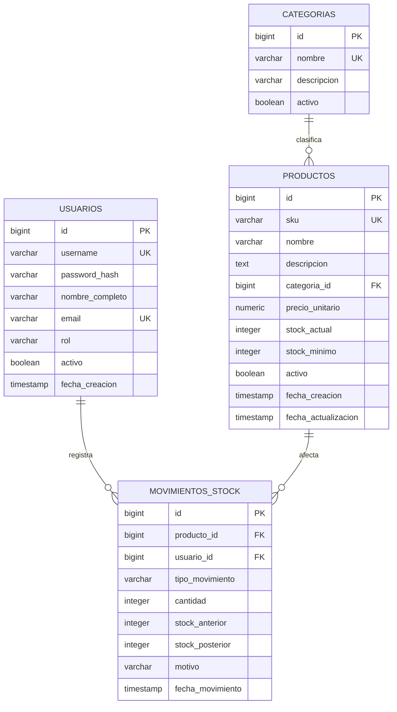

# ESTADO ACTUAL DEL PROYECTO

## Datos del Repositorio y Equipo
*   **Repositorio GitHub:** [https://github.com/tiniaAa/sistema-inventario-gds](https://github.com/tiniaAa/sistema-inventario-gds)
*   **Equipo de Desarrollo:**
    *   `@tiniaAa` (Project Lead / Backend Core / Seguridad)
    *   `@mateomujica` (Frontend / Catálogo de Productos)
    *   `@iFaustoo` (Vistas / Auditoría / Alertas y Reportes)

## 1. Problema y Propuesta
*   **Necesidad:** Pequeños comercios y depósitos minoristas gestionan su stock de forma manual (planillas de cálculo o papel), lo que genera discrepancias entre el stock físico y el registrado, pérdidas económicas por quiebre de stock y demoras en la reposición de mercadería.
*   **Destinatarios:** Encargados de depósito, administradores de inventario y personal de ventas de PyMEs comerciales.
*   **Producto propuesto:** Aplicación web de gestión de inventario ("StockMaster") que centraliza el catálogo de productos, audita movimientos de entrada/salida de stock en tiempo real y notifica cuando los niveles caen por debajo del punto de reorden.
*   **Beneficio:** Reducción de los tiempos de carga en un 60%, eliminación de errores manuales de registro y prevención de faltantes de productos críticos mediante alertas tempranas.

## 2. Alcance y Limitaciones
*   **Dentro del alcance:**
    *   Autenticación y roles de usuario (Administrador y Operador de depósito).
    *   Gestión de catálogo de productos (CRUD con categorías, precios y SKU/código de barras).
    *   Registro y trazabilidad de movimientos de inventario (ingresos, egresos, ajustes por merma).
    *   Sistema de alertas de stock mínimo.
    *   Exportación de reportes de existencias a formato CSV.
*   **Fuera del alcance:**
    *   Integración con pasarelas de pago o puntos de venta físicos (POS).
    *   Facturación electrónica fiscal.
    *   Módulo logístico de ruteo de envíos o geolocalización de camiones.
*   **Limitaciones:** Plazo estricto del cuatrimestre académico, infraestructura en planes gratuitos de despliegue y disponibilidad horaria del equipo limitada a 10 horas semanales por integrante.

## 3, 4 y 11. Backlog de Funcionalidades (Requisito: Mínimo 12)
*Criterio de finalización (Definition of Done): La funcionalidad cumple con los criterios de aceptación, cuenta con validaciones de datos en frontend y backend, fue probada localmente y en staging sin errores bloqueantes, y posee su Pull Request mergeado en la rama principal tras code review.*

| ID | Funcionalidad (Historia de Usuario) | Prioridad | Asignado | Estado actual |
|:---|:---|:---|:---|:---|
| 1 | **Autenticación:** Como usuario, quiero iniciar sesión con credenciales seguras para acceder a las funciones según mi rol asignado. | Alta | @tiniaAa | Pendiente |
| 2 | **Alta de producto:** Como operador, quiero registrar un nuevo producto con nombre, SKU, categoría, precio y stock inicial para incorporarlo al catálogo. | Alta | @mateomujica | Pendiente |
| 3 | **Modificación de producto:** Como operador, quiero editar los datos comerciales y descripción de un producto para mantener la información actualizada. | Media | @mateomujica | Pendiente |
| 4 | **Baja lógica de producto:** Como administrador, quiero deshabilitar productos obsoletos sin borrarlos físicamente para no romper la integridad de auditorías pasadas. | Media | @mateomujica | Pendiente |
| 5 | **Listado y búsqueda:** Como usuario, quiero buscar productos por nombre, SKU o categoría con paginación para encontrar ítems rápidamente. | Alta | @iFaustoo | Pendiente |
| 6 | **Gestión de categorías:** Como administrador, quiero crear, editar y listar categorías para organizar y segmentar los productos en depósito. | Baja | @mateomujica | Pendiente |
| 7 | **Ingreso de stock:** Como operador, quiero registrar la entrada de unidades asociada a un remito o proveedor para sumar existencia física al sistema. | Alta | @tiniaAa | Pendiente |
| 8 | **Egreso de stock:** Como operador, quiero registrar la salida de mercadería con su motivo correspondiente (venta, traslado) para descontar existencias. | Alta | @tiniaAa | Pendiente |
| 9 | **Ajuste por merma/pérdida:** Como administrador, quiero registrar ajustes manuales por roturas o pérdidas justificadas para corregir desvíos con el stock real. | Media | @tiniaAa | Pendiente |
| 10 | **Alertas de stock mínimo:** Como encargado, quiero ver un indicador visual de alerta cuando un ítem caiga por debajo de su umbral mínimo para ordenar reposición. | Alta | @iFaustoo | Pendiente |
| 11 | **Historial de movimientos:** Como administrador, quiero auditar el registro cronológico de entradas y salidas con usuario, fecha y motivo para controlar desvíos. | Media | @iFaustoo | Pendiente |
| 12 | **Exportación de inventario:** Como administrador, quiero exportar el listado de inventario valorizado a formato CSV para balances y presentaciones contables. | Baja | @iFaustoo | Pendiente |

## 5 y 12. Estimaciones e Indicadores
*   **Indicador 1 (Avance general):** 0/12 funcionalidades terminadas (0% de progreso del backlog).
*   **Indicador 2 (Estimación vs Realidad):** Planificado: 80 Story Points (SP) totales distribuidos en 2 etapas. Consumidos a la fecha: 0 SP. Desvío actual: 0%.

## 6. Desarrollo en Etapas (Requisito: Mínimo 2)
### Etapa 1: Core del Sistema y Catálogo
*   **Propósito:** Establecer la arquitectura base, modelo de datos relacional, control de acceso y el CRUD completo de catálogo de productos.
*   **Tareas seleccionadas:** IDs 1, 2, 3, 4, 5, 6 (Total: 38 Story Points).
*   **Estado:** En proceso

### Etapa 2: Control Operativo, Movimientos y Reportes
*   **Propósito:** Implementar la lógica transaccional de movimientos de stock, auditoría, alertas en tiempo real y módulo de reportes.
*   **Tareas seleccionadas:** IDs 7, 8, 9, 10, 11, 12 (Total: 42 Story Points).
*   **Estado:** Pendiente

## 9. Posibles Problemas (Requisito: Mínimo 4)
*   **Riesgo 1 (Concurrencia en actualización de stock):** Dos operadores registran egresos simultáneos del mismo producto → **Consecuencia:** Inconsistencia de datos, saldo de stock negativo y condiciones de carrera (race conditions) en la base de datos → **Estrategia de mitigación:** Implementar transacciones de base de datos con bloqueo pesimista o restricciones de nivel de aislamiento (`SELECT FOR UPDATE` / transacciones serializables) y validaciones a nivel de constraint (`CHECK (stock >= 0)`).
*   **Riesgo 2 (Descoordinación en ramas de Git):** Múltiples desarrolladores trabajando en la entidad Producto en paralelo → **Consecuencia:** Conflictos graves de merge, sobrescritura de código y retrasos en la integración hacia la rama principal → **Estrategia de mitigación:** Adopción estricta de GitHub Flow, ramas cortas por funcionalidad (`feature/HU-xx`), pull requests obligatorios con revisión de al menos un par y bloqueos de merge si no pasan las validaciones locales.
*   **Riesgo 3 (Pérdida de integridad referencial al eliminar productos):** Intentar borrar productos que ya poseen historial de ingresos o egresos → **Consecuencia:** Fallas de clave foránea en base de datos o pérdida de datos históricos de auditoría contable → **Estrategia de mitigación:** Aplicar patrón de baja lógica (*soft delete*) mediante un campo booleano `activo = false` o `deleted_at`, impidiendo la eliminación física (`DELETE`) en cascada.
*   **Riesgo 4 (Desborde de alcance por funcionalidades secundarias):** Dedicar tiempo excesivo al diseño visual o pretender integrar facturación/impresión fiscal → **Consecuencia:** Incumplimiento del plazo de entrega de la Etapa 2 y falta de tiempo para testing funcional → **Estrategia de mitigación:** Priorización MoSCoW estricta en el backlog; rechazar toda funcionalidad fuera del alcance hasta tener las 12 historias básicas totalmente probadas y desplegadas.

## 10 y 13. Secuencias de Decisión y Cambios (Requisito: Mínimo 4)
1.  **Decisión:** Migrar del almacenamiento directo de contraseñas a autenticación robusta mediante JWT con hash bcrypt y expiración de tokens.
    *   **Evidencia:** En la revisión inicial de arquitectura se detectó vulnerabilidad en el manejo de sesiones y falta de separación segura entre perfiles de Administrador y Operador.
    *   **Resultado:** Se implementó middleware de autorización en el backend que valida el token y los roles en cada endpoint sensible.
    *   **Aprendizaje:** La seguridad y el control de acceso deben integrarse desde la fase de diseño y no añadirse como un parche al final del desarrollo.

2.  **Decisión:** Utilizar transacciones explícitas de base de datos (`BEGIN ... COMMIT / ROLLBACK`) para los registros de movimientos de stock.
    *   **Evidencia:** Durante las pruebas unitarias de egreso de stock, si ocurría un fallo de red a mitad del proceso, se insertaba el registro de auditoría pero no se descontaba el valor en la tabla de productos.
    *   **Resultado:** Ambas operaciones (crear movimiento y actualizar stock) se agruparon en una única transacción atómica; si una falla, se cancela todo.
    *   **Aprendizaje:** En sistemas de inventario, la consistencia de datos transaccional es crítica y no debe depender de lógica aislada en la capa de aplicación.

3.  **Decisión:** Implementar paginación del lado del servidor (*Server-Side Pagination*) en el listado de productos en lugar de paginar en el cliente.
    *   **Evidencia:** Con un dataset de prueba de 2.000 productos ficticios, la carga inicial del frontend demoraba más de 3 segundos y consumía memoria excesiva en el navegador.
    *   **Resultado:** Se modificó el endpoint `GET /productos` para aceptar parámetros `page` y `limit`, reduciendo la respuesta de red a menos de 100 ms.
    *   **Aprendizaje:** Nunca diseñar interfaces asumiendo volúmenes pequeños de datos; la escalabilidad debe considerarse en las consultas de lectura desde el inicio.

4.  **Decisión:** Cambio de plan en el alcance: posponer la generación de reportes en PDF y sustituirla por exportación nativa a CSV.
    *   **Evidencia:** La integración de librerías de renderizado de PDF en el servidor presentó dependencias complejas y consumió el doble de tiempo estimado en la Etapa 2.
    *   **Resultado:** Se redefinió la HU 12 para generar CSV mediante streaming simple, cumpliendo el requerimiento de análisis de datos para el usuario sin comprometer la fecha de entrega.
    *   **Aprendizaje:** Ante desvíos de tiempo, es preferible simplificar la complejidad técnica de una tarea secundaria antes que retrasar la entrega de funcionalidades centrales.

## 18. Uso de Inteligencia Artificial
*   **Herramienta:** Asistente LLM (Gemini / Antigravity).
*   **Uso:** Estructuración y redacción del backlog bajo formato de Historias de Usuario, definición de la matriz de riesgos, diseño de esquemas relacionales de base de datos y redacción de secuencias de decisión arquitectónica.
*   **Verificación:** Revisión manual por parte del equipo para garantizar que los modelos de datos, endpoints y riesgos reflejen el código y el repositorio real del proyecto.

## 19. Definición de Arquitectura y Stack Tecnológico

### 19.1 Stack Tecnológico Específico
*   **Frontend:** React (Vite, JavaScript/TypeScript, React Router DOM, Axios, TailwindCSS o Bootstrap).
*   **Backend:** Java 17/21 con Spring Boot 3.x:
    *   **Spring Web:** Creación de controladores REST y endpoints HTTP.
    *   **Spring Security + jjwt:** Autenticación Stateless basada en tokens Bearer JWT y protección de endpoints según roles (`ROLE_ADMIN`, `ROLE_OPERADOR`).
    *   **Spring Data JPA / Hibernate:** Mapeo objeto-relacional (ORM), repositorios y control de transacciones.
    *   **Validation (Hibernate Validator):** Validación declarativa de datos de entrada en DTOs (`@NotNull`, `@Size`, `@PositiveOrZero`).
*   **Base de Datos:** PostgreSQL 15+ (Gestión de restricciones relacionales, soporte de transacciones ACID con niveles de aislamiento y funciones de agregación).
*   **Herramientas de Build y Entorno:** Maven/Gradle en backend, Node.js + npm en frontend, Docker (opcional para levantar la base de datos PostgreSQL local).

### 19.2 Guía de Estilo y Sistema de Diseño UI (Regla Estricta para Frontend)
Para mantener consistencia visual en todos los módulos desarrollados por el equipo y sus IAs, la interfaz debe regirse bajo las siguientes directrices de diseño:

*   **Concepto Visual:** Interfaz tipo Dashboard corporativo / ERP industrial moderno, limpia, funcional y orientada a la eficiencia operativa de almacén (alta densidad de datos sin sobrecarga visual).
*   **Paleta de Colores Semántica:**
    *   **Primario / Identidad:** `#1E40AF` (Navy/Azul corporativo) para sidebar, cabeceras y `#2563EB` (Azul eléctrico) para botones principales y estados activos.
    *   **Stock Normal / Confirmaciones:** `#059669` (Verde esmeralda) con fondo de badge `#DEF7EC` y texto `#03543F`.
    *   **Alerta Stock Mínimo (Advertencia):** `#D97706` (Ámbar) con fondo `#FEF3C7` y texto `#92400E` (se activa automáticamente cuando `stock_actual <= stock_minimo`).
    *   **Quiebre de Stock / Egresos / Peligro:** `#DC2626` (Rojo carmesí) con fondo `#FDE8E8` y texto `#9B1C1C` (indica stock en 0 o errores de validación).
    *   **Fondos y Superficies:** Fondo general `#F8FAFC` (Slate-50), contenedores y tarjetas `#FFFFFF` con bordes sutiles `#E2E8F0` (Slate-200) y sombras suaves (`shadow-sm`).
    *   **Tipografía y Textos:** Tipografía sans-serif (`Inter`, `system-ui`). Títulos en `#0F172A` (Slate-900), cuerpo en `#334155` (Slate-700) y textos secundarios en `#64748B` (Slate-500).
*   **Reglas de Componentes y Tablas:**
    *   **Tablas de Inventario:** Cabeceras con fondo sutil (`bg-slate-100`), texto en mayúsculas pequeñas (`text-xs font-semibold uppercase tracking-wider text-slate-500`). Todas las cifras numéricas (precios, stock, cantidades) deben alinearse a la derecha y utilizar fuente monoespaciada o estilo `tabular-nums`.
    *   **Estructura de Pantalla:** Layout fijo con barra lateral de navegación izquierda (Sidebar), barra superior fija (Header) con indicador del usuario conectado y su rol (`ADMIN` / `OPERADOR`), y contenedor central con tarjetas de métricas (*KPI cards*) y tablas de datos paginadas.
    *   **Formularios y Modales:** Las operaciones de ingreso y egreso rápido deben realizarse mediante ventanas modales con fondo oscurecido (*backdrop-blur*), evitando navegar a páginas externas para transacciones operativas comunes.
    *   **Feedback de Usuario:** Notificaciones emergentes (*Toasts*) temporales en la esquina superior derecha para confirmar transacciones o informar rechazos por stock insuficiente.

---

## 20. Modelo de Datos Relacional (PostgreSQL)

### 20.1 Diagrama Entidad-Relación

### 20.2 Definición Detallada de Tablas y Restricciones

1.  **Tabla: `usuarios`**
    *   `id`: `BIGSERIAL PRIMARY KEY`
    *   `username`: `VARCHAR(50) UNIQUE NOT NULL`
    *   `password_hash`: `VARCHAR(255) NOT NULL` (Hash BCrypt)
    *   `nombre_completo`: `VARCHAR(100) NOT NULL`
    *   `email`: `VARCHAR(100) UNIQUE NOT NULL`
    *   `rol`: `VARCHAR(20) NOT NULL CHECK (rol IN ('ADMIN', 'OPERADOR'))`
    *   `activo`: `BOOLEAN NOT NULL DEFAULT TRUE` (Baja lógica)
    *   `fecha_creacion`: `TIMESTAMP NOT NULL DEFAULT CURRENT_TIMESTAMP`

2.  **Tabla: `categorias`**
    *   `id`: `BIGSERIAL PRIMARY KEY`
    *   `nombre`: `VARCHAR(50) UNIQUE NOT NULL`
    *   `descripcion`: `VARCHAR(255)`
    *   `activo`: `BOOLEAN NOT NULL DEFAULT TRUE` (Baja lógica para no romper asociaciones pasadas)

3.  **Tabla: `productos`**
    *   `id`: `BIGSERIAL PRIMARY KEY`
    *   `sku`: `VARCHAR(50) UNIQUE NOT NULL` (Código identificador o de barras único)
    *   `nombre`: `VARCHAR(100) NOT NULL`
    *   `descripcion`: `TEXT`
    *   `categoria_id`: `BIGINT NOT NULL REFERENCES categorias(id) ON DELETE RESTRICT`
    *   `precio_unitario`: `NUMERIC(12, 2) NOT NULL CHECK (precio_unitario >= 0)`
    *   `stock_actual`: `INTEGER NOT NULL DEFAULT 0 CHECK (stock_actual >= 0)` (Restricción crítica: impide saldos negativos)
    *   `stock_minimo`: `INTEGER NOT NULL DEFAULT 5 CHECK (stock_minimo >= 0)` (Umbral para alertas automáticas)
    *   `activo`: `BOOLEAN NOT NULL DEFAULT TRUE` (Baja lógica: no se borra físicamente para preservar auditorías)
    *   `fecha_creacion`: `TIMESTAMP NOT NULL DEFAULT CURRENT_TIMESTAMP`
    *   `fecha_actualizacion`: `TIMESTAMP NOT NULL DEFAULT CURRENT_TIMESTAMP`

4.  **Tabla: `movimientos_stock` (Auditoría inmutable)**
    *   `id`: `BIGSERIAL PRIMARY KEY`
    *   `producto_id`: `BIGINT NOT NULL REFERENCES productos(id) ON DELETE RESTRICT`
    *   `usuario_id`: `BIGINT NOT NULL REFERENCES usuarios(id) ON DELETE RESTRICT`
    *   `tipo_movimiento`: `VARCHAR(20) NOT NULL CHECK (tipo_movimiento IN ('INGRESO', 'EGRESO', 'AJUSTE_MERMA', 'AJUSTE_SOBRANTE'))`
    *   `cantidad`: `INTEGER NOT NULL CHECK (cantidad > 0)`
    *   `stock_anterior`: `INTEGER NOT NULL CHECK (stock_anterior >= 0)`
    *   `stock_posterior`: `INTEGER NOT NULL CHECK (stock_posterior >= 0)`
    *   `motivo`: `VARCHAR(255) NOT NULL` (Ej: 'Remito proveedor #104', 'Venta orden #552', 'Rotura en depósito')
    *   `fecha_movimiento`: `TIMESTAMP NOT NULL DEFAULT CURRENT_TIMESTAMP`
    *   *Regla de diseño:* Es una tabla append-only (solo `INSERT`). Prohibido ejecutar `UPDATE` o `DELETE` sobre esta tabla.

---

## 21. Mecánica de Trabajo entre Capas (Arquitectura Operativa)

### 21.1 Base de Datos (PostgreSQL)
*   **Garantía de Consistencia (ACID):** Maneja transacciones con nivel de aislamiento estándar `READ COMMITTED`.
*   **Integridad Referencial:** Reglas `ON DELETE RESTRICT` en claves foráneas impiden borrar categorías o productos vinculados a movimientos históricos.
*   **Regla de Oro de Stock:** La restricción `CHECK (stock_actual >= 0)` actúa como última línea de defensa ante cualquier intento de egreso que supere la existencia real.

### 21.2 Backend (Java + Spring Boot)
*   **Arquitectura en Capas:**
    *   `Controller`: Define endpoints REST (`/api/auth`, `/api/productos`, `/api/movimientos`), recibe DTOs validados con `@Valid` y retorna `ResponseEntity<T>` con códigos HTTP semánticos (200, 201, 400, 401, 403, 404).
    *   `Service`: Contiene la lógica de negocio. Para movimientos de stock utiliza métodos anotados con `@Transactional`. En la consulta del producto aplica bloqueo pesimista (`@Lock(LockModeType.PESSIMISTIC_WRITE)`) para evitar condiciones de carrera si dos operadores registran egresos concurrentes.
    *   `Repository`: Interfaces que extienden de `JpaRepository<T, ID>` para operaciones CRUD y consultas derivadas con `Pageable` para la paginación del lado del servidor.
    *   `Security`: Configuración de `SecurityFilterChain` con política `SessionCreationPolicy.STATELESS` y filtro JWT personalizado (`JwtAuthenticationFilter`) que extrae el token del header `Authorization: Bearer <token>`, autenticando el contexto de seguridad.
*   **CORS:** Bean centralizado de `CorsConfigurationSource` habilitando orígenes autorizados (cliente React en desarrollo y producción).

### 21.3 Frontend (React)
*   **Gestión de Estado y Sesión:**
    *   `AuthContext`: Provee el estado global del usuario logueado, sus roles (`ADMIN` u `OPERADOR`) y almacena el JWT en memoria / `localStorage`.
    *   Rutas protegidas mediante componentes envolventes (`<ProtectedRoute roles={['ADMIN']} />`).
*   **Capa de Servicios HTTP:**
    *   Instancia centralizada de Axios con interceptor de petición (inyecta automáticamente `headers.Authorization = Bearer ${token}`) e interceptor de respuesta (captura errores 401/403 para redireccionar al login si el token expiró).
*   **Módulos de Vista:**
    *   *Catálogo:* Tabla paginada consumiendo `page` y `size` del backend, con barras de búsqueda reactivas.
    *   *Operaciones de Depósito:* Formularios modales para registrar ingresos y egresos rápidos validando cantidades antes de enviar.
    *   *Dashboard / Alertas:* Indicadores visuales en rojo cuando `stock_actual <= stock_minimo` y botón de exportación de reporte CSV.

