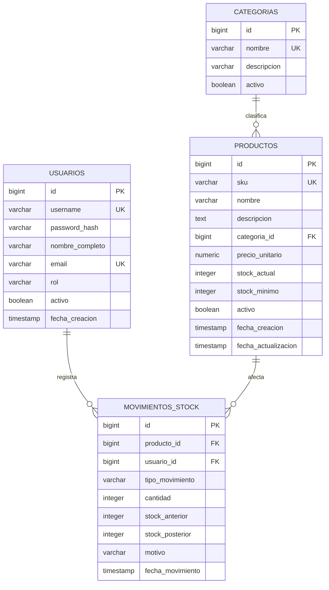

# ESTADO ACTUAL DEL PROYECTO

## Datos del Repositorio y Equipo
*   **Repositorio GitHub:** [https://github.com/tiniaAa/sistema-inventario-gds](https://github.com/tiniaAa/sistema-inventario-gds)
*   **Equipo de Desarrollo:**
    *   `@tiniaAa` (Project Lead / Backend Core / Seguridad)
    *   `@mateomujica` (Frontend / Catálogo de Productos)
    *   `@iFaustoo` (Vistas / Auditoría / Alertas y Reportes)

## 1. Problema y Propuesta
*   **Necesidad:** Pequeños comercios y depósitos minoristas gestionan su stock de forma manual (planillas de cálculo o papel), lo que genera discrepancias entre el stock físico y el registrado, pérdidas económicas por quiebre de stock y demoras en la reposición de mercadería.
*   **Destinatarios:** Encargados de depósito, administradores de inventario y personal de ventas de PyMEs comerciales.
*   **Producto propuesto:** Aplicación web de gestión de inventario ("StockMaster") que centraliza el catálogo de productos, audita movimientos de entrada/salida de stock en tiempo real y notifica cuando los niveles caen por debajo del punto de reorden.
*   **Beneficio:** Reducción de los tiempos de carga en un 60%, eliminación de errores manuales de registro y prevención de faltantes de productos críticos mediante alertas tempranas.

## 2. Alcance y Limitaciones
*   **Dentro del alcance:**
    *   Autenticación y roles de usuario (Administrador y Operador de depósito).
    *   Gestión de catálogo de productos (CRUD con categorías, precios y SKU/código de barras).
    *   Registro y trazabilidad de movimientos de inventario (ingresos, egresos, ajustes por merma).
    *   Sistema de alertas de stock mínimo.
    *   Exportación de reportes de existencias a formato CSV.
*   **Fuera del alcance:**
    *   Integración con pasarelas de pago o puntos de venta físicos (POS).
    *   Facturación electrónica fiscal.
    *   Módulo logístico de ruteo de envíos o geolocalización de camiones.
*   **Limitaciones:** Plazo estricto del cuatrimestre académico, infraestructura en planes gratuitos de despliegue y disponibilidad horaria del equipo limitada a 10 horas semanales por integrante.

## 3, 4 y 11. Backlog de Funcionalidades (Requisito: Mínimo 12)
*Criterio de finalización (Definition of Done): La funcionalidad cumple con los criterios de aceptación, cuenta con validaciones de datos en frontend y backend, fue probada localmente y en staging sin errores bloqueantes, y posee su Pull Request mergeado en la rama principal tras code review.*

| ID | Funcionalidad (Historia de Usuario) | Prioridad | Asignado | Estado actual |
|:---|:---|:---|:---|:---|
| 1 | **Autenticación:** Como usuario, quiero iniciar sesión con credenciales seguras para acceder a las funciones según mi rol asignado. | Alta | @tiniaAa | Pendiente |
| 2 | **Alta de producto:** Como operador, quiero registrar un nuevo producto con nombre, SKU, categoría, precio y stock inicial para incorporarlo al catálogo. | Alta | @mateomujica | Terminada |
| 3 | **Modificación de producto:** Como operador, quiero editar los datos comerciales y descripción de un producto para mantener la información actualizada. | Media | @mateomujica | Terminada |
| 4 | **Baja lógica de producto:** Como administrador, quiero deshabilitar productos obsoletos sin borrarlos físicamente para no romper la integridad de auditorías pasadas. | Media | @mateomujica | Terminada |
| 5 | **Listado y búsqueda:** Como usuario, quiero buscar productos por nombre, SKU o categoría con paginación para encontrar ítems rápidamente. | Alta | @iFaustoo | Pendiente |
| 6 | **Gestión de categorías:** Como administrador, quiero crear, editar y listar categorías para organizar y segmentar los productos en depósito. | Baja | @mateomujica | Pendiente |
| 7 | **Ingreso de stock:** Como operador, quiero registrar la entrada de unidades asociada a un remito o proveedor para sumar existencia física al sistema. | Alta | @tiniaAa | Pendiente |
| 8 | **Egreso de stock:** Como operador, quiero registrar la salida de mercadería con su motivo correspondiente (venta, traslado) para descontar existencias. | Alta | @tiniaAa | Pendiente |
| 9 | **Ajuste por merma/pérdida:** Como administrador, quiero registrar ajustes manuales por roturas o pérdidas justificadas para corregir desvíos con el stock real. | Media | @tiniaAa | Pendiente |
| 10 | **Alertas de stock mínimo:** Como encargado, quiero ver un indicador visual de alerta cuando un ítem caiga por debajo de su umbral mínimo para ordenar reposición. | Alta | @iFaustoo | Pendiente |
| 11 | **Historial de movimientos:** Como administrador, quiero auditar el registro cronológico de entradas y salidas con usuario, fecha y motivo para controlar desvíos. | Media | @iFaustoo | Pendiente |
| 12 | **Exportación de inventario:** Como administrador, quiero exportar el listado de inventario valorizado a formato CSV para balances y presentaciones contables. | Baja | @iFaustoo | Pendiente |

## 5 y 12. Estimaciones e Indicadores
*   **Indicador 1 (Avance general):** 3/12 funcionalidades terminadas (25.00% de progreso del backlog; 0 en proceso; 9 pendientes).
*   **Indicador 2 (Estimación vs Realidad):** Planificado: 80 Story Points (SP) totales distribuidos en 2 etapas. Consumidos a la fecha: 18 SP (HU-02 con 8 SP, HU-03 con 5 SP y HU-04 con 5 SP completadas en Etapa 1). Desvío actual: 0% respecto a la planificación temporal.

## 6. Desarrollo en Etapas (Requisito: Mínimo 2)
### Etapa 1: Core del Sistema y Catálogo
*   **Propósito:** Establecer la arquitectura base, modelo de datos relacional, control de acceso y el CRUD completo de catálogo de productos.
*   **Tareas seleccionadas:** IDs 1, 2, 3, 4, 5, 6 (Total: 38 Story Points).
*   **Estado:** En proceso (HU-02, HU-03 y HU-04 Terminadas; HU-01, 05, 06 Pendientes).

### Etapa 2: Control Operativo, Movimientos y Reportes
*   **Propósito:** Implementar la lógica transaccional de movimientos de stock, auditoría, alertas en tiempo real y módulo de reportes.
*   **Tareas seleccionadas:** IDs 7, 8, 9, 10, 11, 12 (Total: 42 Story Points).
*   **Estado:** Pendiente

## 9. Posibles Problemas (Requisito: Mínimo 4)
*   **Riesgo 1 (Concurrencia en actualización de stock):** Dos operadores registran egresos simultáneos del mismo producto → **Consecuencia:** Inconsistencia de datos, saldo de stock negativo y condiciones de carrera (race conditions) en la base de datos → **Estrategia de mitigación:** Implementar transacciones de base de datos con bloqueo pesimista o restricciones de nivel de aislamiento (`SELECT FOR UPDATE` / transacciones serializables) y validaciones a nivel de constraint (`CHECK (stock >= 0)`).
*   **Riesgo 2 (Descoordinación en ramas de Git):** Múltiples desarrolladores trabajando en la entidad Producto en paralelo → **Consecuencia:** Conflictos graves de merge, sobrescritura de código y retrasos en la integración hacia la rama principal → **Estrategia de mitigación:** Adopción estricta de GitHub Flow, ramas cortas por funcionalidad (`feature/HU-xx`), pull requests obligatorios con revisión de al menos un par y bloqueos de merge si no pasan las validaciones locales.
*   **Riesgo 3 (Pérdida de integridad referencial al eliminar productos):** Intentar borrar productos que ya poseen historial de ingresos o egresos → **Consecuencia:** Fallas de clave foránea en base de datos o pérdida de datos históricos de auditoría contable → **Estrategia de mitigación:** Aplicar patrón de baja lógica (*soft delete*) mediante un campo booleano `activo = false` o `deleted_at`, impidiendo la eliminación física (`DELETE`) en cascada.
*   **Riesgo 4 (Desborde de alcance por funcionalidades secundarias):** Dedicar tiempo excesivo al diseño visual o pretender integrar facturación/impresión fiscal → **Consecuencia:** Incumplimiento del plazo de entrega de la Etapa 2 y falta de tiempo para testing funcional → **Estrategia de mitigación:** Priorización MoSCoW estricta en el backlog; rechazar toda funcionalidad fuera del alcance hasta tener las 12 historias básicas totalmente probadas y desplegadas.
*   **Riesgo 5 (Pérdida de estado en formularios por expiración de token JWT):** Si la sesión del usuario expira mientras redacta datos en `ProductoModal.jsx`, el interceptor de Axios fuerza la redirección al login, destruyendo el estado del formulario → **Consecuencia:** Pérdida de datos ingresados y reprocesamiento manual → **Estrategia de mitigación:** Implementar guardado temporal de borrador en `sessionStorage` o renovación transparente de token con endpoint de refresh antes del envío.
*   **Riesgo 6 (Discrepancias entre mocks unitarios y base de datos real):** Las pruebas unitarias actuales validan controladores con MockMvc y repositorios simulados, sin testear constraints DDL directos en el motor PostgreSQL real → **Consecuencia:** Falsos positivos en pruebas ante violaciones de restricciones físicas (`CHECK (stock_actual >= 0)`) o bloqueos de transacciones concurrentes → **Estrategia de mitigación:** Incorporar pruebas de integración con Testcontainers ejecutando una instancia real de PostgreSQL en el flujo de CI.
*   **Riesgo 7 (Desincronización de categorías activas en modales abiertos de edición):** Si una categoría es dada de baja por un administrador mientras un operador edita un producto con el modal abierto → **Consecuencia:** La interfaz permite seleccionar una categoría inactiva y la operación falla recién en el backend con HTTP 400 sin advertencia reactiva previa → **Estrategia de mitigación:** Capturar el error 400 con mensaje semántico en el cliente ofreciendo recargar las categorías activas, o integrar sondeo/WebSockets para invalidación en caliente del selector.
*   **Riesgo 8 (Irreversibilidad de bajas lógicas sin mecanismo de reactivación):** Ausencia de endpoints o interfaz para reactivar productos (`activo = true`) inhabilitados por equivocación → **Consecuencia:** Imposibilidad de restaurar ítems deshabilitados por error desde la aplicación web, obligando a intervenciones manuales en la base de datos SQL con riesgo de alterar auditorías → **Estrategia de mitigación:** Diseñar un endpoint `PATCH /api/productos/{id}/reactivar` restringido exclusivamente al rol `ADMIN` con diálogo de confirmación en la UI.
*   **Riesgo 9 (Opacidad de catálogo histórico de productos deshabilitados):** Las consultas de listado en `ProductoRepository` (`findByActivoTrue` y `searchActivos`) excluyen de forma permanente los registros inactivos → **Consecuencia:** Los administradores no disponen de una vista para auditar o supervisar el catálogo de productos históricos dados de baja → **Estrategia de mitigación:** Añadir un parámetro booleano `incluirInactivos` en los endpoints de catálogo y un selector de filtrado en la cabecera de la tabla de productos para usuarios con rol `ADMIN`.

## 10 y 13. Secuencias de Decisión y Cambios (Requisito: Mínimo 4)
1.  **Decisión:** Migrar del almacenamiento directo de contraseñas a autenticación robusta mediante JWT con hash bcrypt y expiración de tokens.
    *   **Evidencia:** En la revisión inicial de arquitectura se detectó vulnerabilidad en el manejo de sesiones y falta de separación segura entre perfiles de Administrador y Operador.
    *   **Resultado:** Se implementó middleware de autorización en el backend que valida el token y los roles en cada endpoint sensible.
    *   **Aprendizaje:** La seguridad y el control de acceso deben integrarse desde la fase de diseño y no añadirse como un parche al final del desarrollo.

2.  **Decisión:** Utilizar transacciones explícitas de base de datos (`BEGIN ... COMMIT / ROLLBACK`) para los registros de movimientos de stock.
    *   **Evidencia:** Durante las pruebas unitarias de egreso de stock, si ocurría un fallo de red a mitad del proceso, se insertaba el registro de auditoría pero no se descontaba el valor en la tabla de productos.
    *   **Resultado:** Ambas operaciones (crear movimiento y actualizar stock) se agruparon en una única transacción atómica; si una falla, se cancela todo.
    *   **Aprendizaje:** En sistemas de inventario, la consistencia de datos transaccional es crítica y no debe depender de lógica aislada en la capa de aplicación.

3.  **Decisión:** Implementar paginación del lado del servidor (*Server-Side Pagination*) en el listado de productos en lugar de paginar en el cliente.
    *   **Evidencia:** Con un dataset de prueba de 2.000 productos ficticios, la carga inicial del frontend demoraba más de 3 segundos y consumía memoria excesiva en el navegador.
    *   **Resultado:** Se modificó el endpoint `GET /productos` para aceptar parámetros `page` y `limit`, reduciendo la respuesta de red a menos de 100 ms.
    *   **Aprendizaje:** Nunca diseñar interfaces asumiendo volúmenes pequeños de datos; la escalabilidad debe considerarse en las consultas de lectura desde el inicio.

4.  **Decisión:** Cambio de plan en el alcance: posponer la generación de reportes en PDF y sustituirla por exportación nativa a CSV.
    *   **Evidencia:** La integración de librerías de renderizado de PDF en el servidor presentó dependencias complejas y consumió el doble de tiempo estimado en la Etapa 2.
    *   **Resultado:** Se redefinió la HU 12 para generar CSV mediante streaming simple, cumpliendo el requerimiento de análisis de datos para el usuario sin comprometer la fecha de entrega.
    *   **Aprendizaje:** Ante desvíos de tiempo, es preferible simplificar la complejidad técnica de una tarea secundaria antes que retrasar la entrega de funcionalidades centrales.

5.  **Decisión:** Carga estática obligatoria del agente ByteBuddy en Maven Surefire bajo Java 21 en Windows.
    *   **Evidencia:** Durante la ejecución de `ProductoControllerTest`, la suite se bloqueó indefinidamente (>20 minutos) con error `Win32 Error 5: ERROR_ACCESS_DENIED` al intentar adjuntar dinámicamente el agente Mockito/ByteBuddy a través de Named Pipes del sistema operativo.
    *   **Resultado:** Se configuró el plugin `maven-surefire-plugin` con el parámetro `-javaagent` apuntando al jar de ByteBuddy en el repositorio local `.m2`, reduciendo el tiempo de ejecución a 2.1 segundos.
    *   **Aprendizaje:** En plataformas Windows y versiones recientes de Java, la Attach API en tiempo de ejecución puede ser bloqueada por permisos del sistema; las herramientas de instrumentación deben precargarse en el arranque de la JVM.

6.  **Decisión:** Validación preventiva de unicidad de SKU en capa de servicio y captura semántica de colisiones.
    *   **Evidencia:** Al intentar registrar productos con códigos SKU existentes, la base de datos lanzaba una violación de constraint relacional no controlada, retornando `500 Internal Server Error` sin mensaje descriptivo hacia el frontend.
    *   **Resultado:** Se introdujo la verificación `productoRepository.existsBySku()` previa a la persistencia y se configuró en `GlobalExceptionHandler` la captura de `IllegalArgumentException` (400) y `DataIntegrityViolationException` (409).
    *   **Aprendizaje:** La capa de aplicación debe validar las invariantes de negocio antes de golpear la base de datos para brindar retroalimentación clara y evitar transacciones fallidas en el motor.

7.  **Decisión:** Inyección transaccional de movimiento de INGRESO al crear productos con stock inicial positivo.
    *   **Evidencia:** Al dar de alta un producto con `stockInicial > 0`, las existencias se reflejaban en la tabla `productos` pero quedaban ausentes en `movimientos_stock`, violando la regla de trazabilidad inmutable del sistema contable.
    *   **Resultado:** Se incorporó dentro del método `@Transactional` de alta la persistencia automática de un registro en `movimientos_stock` con `TipoMovimiento.INGRESO` asociado al usuario en sesión.
    *   **Aprendizaje:** En arquitecturas de inventario balanceadas, ningún saldo puede materializarse sin un movimiento contable que lo justifique.

8.  **Decisión:** Ejecución directa del binario local de Apache Maven ante fallas de resolución DNS en scripts de bootstrap del wrapper.
    *   **Evidencia:** El ejecutable `mvnw.cmd` carecía localmente de `maven-wrapper.jar` e intentó descargarlo vía PowerShell contra `repo.maven.apache.org`, fallando por `WebException: No se puede resolver el nombre remoto` debido a restricciones de red en el entorno de ejecución.
    *   **Resultado:** Se utilizó de forma directa el binario `mvn.cmd` de una distribución local preinstalada de Maven 3.9 sobre Java 21 LTS, ejecutando el ciclo de build y tests sin bloqueos de red.
    *   **Aprendizaje:** En entornos de desarrollo con políticas estrictas de red o sin salida a internet abierta, los scripts de wrapper dinámico fallan; es indispensable disponer de un runtime de compilación local desacoplado de dependencias web inmediatas.

9.  **Decisión:** Consulta de unicidad de SKU con exclusión de identidad propia (`existsBySkuAndIdNot`) en operaciones de actualización.
    *   **Evidencia:** Al actualizar datos comerciales (precio, descripción) de un producto manteniendo el mismo SKU, la consulta `existsBySku(sku)` detectaba la propia fila en base de datos arrojando un falso positivo y bloqueando la solicitud con HTTP 400.
    *   **Resultado:** Se implementó `Boolean existsBySkuAndIdNot(String sku, Long id)` en `ProductoRepository`, generando la condición SQL `WHERE sku = ? AND id <> ?` y permitiendo la actualización idempotente del SKU original.
    *   **Aprendizaje:** La validación de unicidad en modificaciones (*UPDATE*) debe formularse siempre como no-colisión contra terceros, excluyendo explícitamente el identificador de la entidad bajo mutación.

10. **Decisión:** Blindaje e inmutabilidad de saldos de stock durante la modificación comercial de productos.
    *   **Evidencia:** El DTO de solicitud exponía campos de stock; si se mapeaban indiscriminadamente en el método `PUT /api/productos/{id}`, se permitía alterar existencias arbitrariamente omitiendo la auditoría inmutable de `movimientos_stock`.
    *   **Resultado:** Se desacopló la lógica de asignación en `ProductoController` para modificar únicamente atributos comerciales (`nombre`, `descripcion`, `categoria`, `precioUnitario`, `stockMinimo`, `sku`), ignorando cualquier valor de existencias y requiriendo que los cambios de stock se efectúen exclusivamente vía movimientos.
    *   **Aprendizaje:** Los atributos contables sujetos a auditoría estricta no deben compartir ciclo de vida ni endpoints de edición con los datos descriptivos de un producto.

11. **Decisión:** Contexto transaccional explícito (@Transactional) y control de idempotencia semántica en bajas lógicas.
    *   **Evidencia:** El método `bajaLogica` se ejecutaba sin garantía transaccional y permitía peticiones de baja sobre productos ya inactivos (`activo = false`), respondiendo erróneamente con éxito sin verificar el estado previo de la entidad.
    *   **Resultado:** Se anotó el endpoint con `@Transactional` y se añadió la comprobación `Boolean.FALSE.equals(producto.getActivo())`, retornando error HTTP 400 Bad Request estructurado ante intentos de baja reiterada.
    *   **Aprendizaje:** Las operaciones de mutación destructiva deben ser atómicas y validar precondiciones de idempotencia semántica para evitar operaciones redundantes o inconsistencias en la sesión del ORM.

12. **Decisión:** Sincronización de autorización y restricciones de rol en la capa visual (Defense-in-Depth).
    *   **Evidencia:** La grilla de productos mostraba el botón de baja lógica habilitado para cualquier usuario; al pulsarlo un operador, el backend rechazaba la acción con HTTP 403 Forbidden sin una comunicación preventiva clara en la interfaz.
    *   **Resultado:** Se integró el hook `useAuth()` en `Productos.jsx` para comprobar si el usuario posee rol `ADMIN`; para operadores, el disparador se inhabilita con estilo `cursor-not-allowed` y tooltip explicativo, impidiendo peticiones no autorizadas.
    *   **Aprendizaje:** El control de acceso debe diseñarse en profundidad: el backend asegura la inviolabilidad de los datos, mientras que el frontend anticipa las restricciones de rol para garantizar una experiencia operativa intuitiva y sin fricciones.

## 18. Uso de Inteligencia Artificial
*   **Herramienta:** Asistente LLM (Gemini / Antigravity).
*   **Uso:** Estructuración y redacción del backlog bajo formato de Historias de Usuario, definición de la matriz de riesgos, diseño de esquemas relacionales de base de datos y redacción de secuencias de decisión arquitectónica.
*   **Verificación:** Revisión manual por parte del equipo para garantizar que los modelos de datos, endpoints y riesgos reflejen el código y el repositorio real del proyecto.

## 19. Definición de Arquitectura y Stack Tecnológico

### 19.1 Stack Tecnológico Específico
*   **Frontend:** React (Vite, JavaScript/TypeScript, React Router DOM, Axios, TailwindCSS o Bootstrap).
*   **Backend:** Java 17/21 con Spring Boot 3.x:
    *   **Spring Web:** Creación de controladores REST y endpoints HTTP.
    *   **Spring Security + jjwt:** Autenticación Stateless basada en tokens Bearer JWT y protección de endpoints según roles (`ROLE_ADMIN`, `ROLE_OPERADOR`).
    *   **Spring Data JPA / Hibernate:** Mapeo objeto-relacional (ORM), repositorios y control de transacciones.
    *   **Validation (Hibernate Validator):** Validación declarativa de datos de entrada en DTOs (`@NotNull`, `@Size`, `@PositiveOrZero`).
*   **Base de Datos:** PostgreSQL 15+ (Gestión de restricciones relacionales, soporte de transacciones ACID con niveles de aislamiento y funciones de agregación).
*   **Herramientas de Build y Entorno:** Maven/Gradle en backend, Node.js + npm en frontend, Docker (opcional para levantar la base de datos PostgreSQL local).

### 19.2 Guía de Estilo y Sistema de Diseño UI (Referencia Obligatoria a DESIGN.md)
**INSTRUCCIÓN ESTRICTA PARA CUALQUIER IA O DESARROLLADOR:**
Todo el diseño, la maquetación visual, los componentes interactivos, la paleta de colores y las directrices de interfaz de usuario de este proyecto están especificados de forma exhaustiva e inmutable en el archivo:
👉 **[DESIGN.md](DESIGN.md)** (ubicado en la raíz del repositorio).

Cualquier IA que genere o modifique código frontend **DEBE leer e interpretar obligatoriamente el archivo `DESIGN.md`** antes de escribir estilos o componentes, y apegarse con precisión milimétrica a sus tokens y reglas:
1. **Filosofía Acromática / Monocromática (shadcn / Vercel / Linear):**
   * **Fondo general (Canvas):** `#f5f5f5`
   * **Tarjetas y modales (Paper):** `#ffffff` con borde hairline de 1px en `#e5e5e5` y sombra sutil apilada (`--shadow-subtle`).
   * **Superficie de barra lateral (Sidebar Surface):** `#fafafa`
   * **Textos y títulos (Ink):** `#0a0a0a` (primario), `#171717` (ink soft) y `#737373` (secundario / mid-gray).
   * **Botón primario:** Fondo oscuro invertido `#0a0a0a`, texto `#fafafa`, radio de 18px.
   * **Botón secundario / ghost:** Fondo `#f5f5f5`, texto `#0a0a0a`, radio de 18px.
   * **Inputs:** Fondo `#f5f5f5` en reposo, texto `#0a0a0a`, sin borde en reposo y aro de 1px `#e5e5e5` en foco, radio de 18px.
   * **Único color de acento cromático:** `#e7000b` (Ember), reservado **exclusivamente** para estados destructivos o de error. Queda estrictamente prohibido introducir paletas azules, verdes o degradados.
2. **Jerarquía Estricta de Bordes Redondeados (Border Radius):**
   * **18px (`rounded-[18px]`):** Para todos los elementos interactivos (botones, inputs y badges cápsula).
   * **24px (`rounded-[24px]`):** Exclusivamente para contenedores y tarjetas (`cards`).
   * Queda prohibido usar esquinas cuadradas o radios distintos a 18px y 24px.
3. **Tipografía:**
   * Basada en `Geist` (o `Inter` como sustituto del sistema), con tracking ajustado (`-0.05em` en display, `-0.025em` en encabezados). Tablas y cifras con estilo monoespaciado o `tabular-nums`.

---

## 20. Modelo de Datos Relacional (PostgreSQL)

### 20.1 Diagrama Entidad-Relación



### 20.2 Definición Detallada de Tablas y Restricciones

1.  **Tabla: `usuarios`**
    *   `id`: `BIGSERIAL PRIMARY KEY`
    *   `username`: `VARCHAR(50) UNIQUE NOT NULL`
    *   `password_hash`: `VARCHAR(255) NOT NULL` (Hash BCrypt)
    *   `nombre_completo`: `VARCHAR(100) NOT NULL`
    *   `email`: `VARCHAR(100) UNIQUE NOT NULL`
    *   `rol`: `VARCHAR(20) NOT NULL CHECK (rol IN ('ADMIN', 'OPERADOR'))`
    *   `activo`: `BOOLEAN NOT NULL DEFAULT TRUE` (Baja lógica)
    *   `fecha_creacion`: `TIMESTAMP NOT NULL DEFAULT CURRENT_TIMESTAMP`

2.  **Tabla: `categorias`**
    *   `id`: `BIGSERIAL PRIMARY KEY`
    *   `nombre`: `VARCHAR(50) UNIQUE NOT NULL`
    *   `descripcion`: `VARCHAR(255)`
    *   `activo`: `BOOLEAN NOT NULL DEFAULT TRUE` (Baja lógica para no romper asociaciones pasadas)

3.  **Tabla: `productos`**
    *   `id`: `BIGSERIAL PRIMARY KEY`
    *   `sku`: `VARCHAR(50) UNIQUE NOT NULL` (Código identificador o de barras único)
    *   `nombre`: `VARCHAR(100) NOT NULL`
    *   `descripcion`: `TEXT`
    *   `categoria_id`: `BIGINT NOT NULL REFERENCES categorias(id) ON DELETE RESTRICT`
    *   `precio_unitario`: `NUMERIC(12, 2) NOT NULL CHECK (precio_unitario >= 0)`
    *   `stock_actual`: `INTEGER NOT NULL DEFAULT 0 CHECK (stock_actual >= 0)` (Restricción crítica: impide saldos negativos)
    *   `stock_minimo`: `INTEGER NOT NULL DEFAULT 5 CHECK (stock_minimo >= 0)` (Umbral para alertas automáticas)
    *   `activo`: `BOOLEAN NOT NULL DEFAULT TRUE` (Baja lógica: no se borra físicamente para preservar auditorías)
    *   `fecha_creacion`: `TIMESTAMP NOT NULL DEFAULT CURRENT_TIMESTAMP`
    *   `fecha_actualizacion`: `TIMESTAMP NOT NULL DEFAULT CURRENT_TIMESTAMP`

4.  **Tabla: `movimientos_stock` (Auditoría inmutable)**
    *   `id`: `BIGSERIAL PRIMARY KEY`
    *   `producto_id`: `BIGINT NOT NULL REFERENCES productos(id) ON DELETE RESTRICT`
    *   `usuario_id`: `BIGINT NOT NULL REFERENCES usuarios(id) ON DELETE RESTRICT`
    *   `tipo_movimiento`: `VARCHAR(20) NOT NULL CHECK (tipo_movimiento IN ('INGRESO', 'EGRESO', 'AJUSTE_MERMA', 'AJUSTE_SOBRANTE'))`
    *   `cantidad`: `INTEGER NOT NULL CHECK (cantidad > 0)`
    *   `stock_anterior`: `INTEGER NOT NULL CHECK (stock_anterior >= 0)`
    *   `stock_posterior`: `INTEGER NOT NULL CHECK (stock_posterior >= 0)`
    *   `motivo`: `VARCHAR(255) NOT NULL` (Ej: 'Remito proveedor #104', 'Venta orden #552', 'Rotura en depósito')
    *   `fecha_movimiento`: `TIMESTAMP NOT NULL DEFAULT CURRENT_TIMESTAMP`
    *   *Regla de diseño:* Es una tabla append-only (solo `INSERT`). Prohibido ejecutar `UPDATE` o `DELETE` sobre esta tabla.

---

## 21. Mecánica de Trabajo entre Capas (Arquitectura Operativa)

### 21.1 Base de Datos (PostgreSQL)
*   **Garantía de Consistencia (ACID):** Maneja transacciones con nivel de aislamiento estándar `READ COMMITTED`.
*   **Integridad Referencial:** Reglas `ON DELETE RESTRICT` en claves foráneas impiden borrar categorías o productos vinculados a movimientos históricos.
*   **Regla de Oro de Stock:** La restricción `CHECK (stock_actual >= 0)` actúa como última línea de defensa ante cualquier intento de egreso que supere la existencia real.

### 21.2 Backend (Java + Spring Boot)
*   **Arquitectura en Capas:**
    *   `Controller`: Define endpoints REST (`/api/auth`, `/api/productos`, `/api/movimientos`), recibe DTOs validados con `@Valid` y retorna `ResponseEntity<T>` con códigos HTTP semánticos (200, 201, 204, 400, 401, 403, 404, 409).
    *   `Service`: Contiene la lógica de negocio. Para movimientos de stock utiliza métodos anotados con `@Transactional`. En la consulta del producto aplica bloqueo pesimista (`@Lock(LockModeType.PESSIMISTIC_WRITE)`) para evitar condiciones de carrera si dos operadores registran egresos concurrentes.
    *   `Repository`: Interfaces que extienden de `JpaRepository<T, ID>` para operaciones CRUD y consultas derivadas con `Pageable` para la paginación del lado del servidor.
    *   `Security`: Configuración de `SecurityFilterChain` con política `SessionCreationPolicy.STATELESS` y filtro JWT personalizado (`JwtAuthenticationFilter`) que extrae el token del header `Authorization: Bearer <token>`, autenticando el contexto de seguridad.
*   **CORS:** Bean centralizado de `CorsConfigurationSource` habilitando orígenes autorizados (cliente React en desarrollo y producción).

### 21.3 Frontend (React)
*   **Gestión de Estado y Sesión:**
    *   `AuthContext`: Provee el estado global del usuario logueado, sus roles (`ADMIN` u `OPERADOR`) y almacena el JWT en memoria / `localStorage`.
    *   Rutas protegidas mediante componentes envolventes (`<ProtectedRoute roles={['ADMIN']} />`).
*   **Capa de Servicios HTTP:**
    *   Instancia centralizada de Axios con interceptor de petición (inyecta automáticamente `headers.Authorization = Bearer ${token}`) e interceptor de respuesta (captura errores 401/403 para redireccionar al login si el token expiró).
*   **Módulos de Vista:**
    *   *Catálogo:* Tabla paginada consumiendo `page` y `size` del backend, con barras de búsqueda reactivas, modal dual para alta y modificación comercial de productos, modal de baja lógica con acento destructivo y control de permisos por rol.
    *   *Operaciones de Depósito:* Formularios modales para registrar ingresos y egresos rápidos validando cantidades antes de enviar.
    *   *Dashboard / Alertas:* Indicadores visuales y tablas cuando `stock_actual <= stock_minimo` y botón de exportación de reporte CSV.

---

## 22. Estructura Física del Repositorio y Mapeo de Archivos

El repositorio está organizado como un **Monorepo** dividido en dos módulos independientes (`front` y `back`) con configuración de `.gitignore` en la raíz.

```text
sistema-inventario-gds/
├── .gitignore               # Exclusiones de Git (node_modules, target, .env, .class)
├── contexto.md              # Documentación integral, reglas y estado del proyecto
├── DESIGN.md                # Sistema de diseño UI normativo (reglas de diseño para la IA)
├── README.md                # Guía de desarrollo y prompt estandarizado para las IAs
├── tablero.md               # Tablero de control de KPIs y métricas de avance
├── front/                   # Módulo Cliente (SPA en React)
└── back/                    # Módulo Servidor (API REST en Spring Boot)
```

### 22.1 Módulo Frontend (`front/`)

#### Tecnologías y Librerías:
*   **Framework base:** React 18 + Vite 5 (Bundler ultrarrápido).
*   **Enrutamiento:** `react-router-dom` v6 (Rutas públicas y privadas protegidas por rol).
*   **Cliente HTTP:** `axios` v1.6 (Instancia configurada con interceptores Bearer y control de errores 401/403).
*   **Iconografía:** `lucide-react` (Iconos vectoriales minimalistas y funcionales a 1.5–2px de grosor).
*   **Estilos:** `tailwindcss` v3 + `postcss` + `autoprefixer` (Tokens acromáticos de `DESIGN.md`: canvas, paper, ink, hairline, ember).

#### Árbol de Archivos y Responsabilidades:
```text
front/
├── index.html                       # HTML base de la aplicación (Geist/Inter en canvas #f5f5f5)
├── package.json                     # Scripts (dev, build) y dependencias frontend
├── postcss.config.js                # Plugins de procesamiento CSS
├── tailwind.config.js               # Tokens de diseño de DESIGN.md (18px/24px radii, colores acromáticos)
├── vite.config.js                   # Configuración del servidor de desarrollo (puerto 5173)
├── README.md                        # Instrucciones de ejecución del frontend
└── src/
    ├── main.jsx                     # Punto de entrada de React en el DOM
    ├── App.jsx                      # Definición de rutas protegidas y Layout principal
    ├── index.css                    # Directivas Tailwind y utilidades (tabular-nums)
    ├── api/
    │   └── axios.js                 # Cliente Axios preconfigurado con token Bearer automático
    ├── context/
    │   └── AuthContext.jsx          # Contexto global de autenticación, token y verificación de roles
    ├── components/
    │   ├── common/
    │   │   ├── Badge.jsx            # Badges visuales de estado y StockBadge semántico
    │   │   └── ProtectedRoute.jsx   # Guardián de rutas autenticadas y filtradas por rol
    │   ├── layout/
    │   │   └── Navbar.jsx           # Barra superior con navegación segmentada, perfil y logout
    │   └── productos/
    │       ├── ProductoModal.jsx    # Modal dual (alta y edición) de producto con validaciones y DESIGN.md
    │       └── ConfirmDeleteModal.jsx # Modal de confirmación de baja lógica con acento destructivo Ember
    └── pages/
        ├── Login.jsx                # Formulario de inicio de sesión con JWT
        ├── Dashboard.jsx            # Hub operativo con recuadros interactivos y alertas de stock (HU-10)
        ├── Productos.jsx            # Catálogo con búsqueda, modal dual, modal de baja y control de rol (HU-02..05)
        ├── Movimientos.jsx          # Historial y registro de ingresos, egresos y mermas (HU-07, HU-08, HU-11)
        ├── Categorias.jsx           # Gestión de categorías para administradores (HU-06)
        └── Reportes.jsx             # Módulo de exportación de inventario valorizado a CSV (HU-12)
```

---

### 22.2 Módulo Backend (`back/`)

#### Tecnologías y Librerías:
*   **Lenguaje y Runtime:** Java 17 / 21 LTS.
*   **Framework:** Spring Boot 3.2.4 (`spring-boot-starter-web`, `spring-boot-starter-data-jpa`, `spring-boot-starter-security`, `spring-boot-starter-validation`).
*   **Seguridad:** Spring Security 6 + `jjwt` (Java JWT v0.11.5) para autenticación sin estado (*Stateless*).
*   **Base de Datos:** PostgreSQL 15+ (`org.postgresql:postgresql`).
*   **Testing:** Spring Boot Starter Test (JUnit 5, Mockito 5 con agente ByteBuddy estático).
*   **Productividad:** `lombok` (Reducción de boilerplate para getters, setters y builders).

#### Árbol de Archivos y Responsabilidades:
```text
back/
├── pom.xml                          # Descriptor Maven con dependencias y argLine de Surefire
├── README.md                        # Guía de configuración y arranque del backend
└── src/
    ├── main/
    │   ├── resources/
    │   │   ├── application.properties # Parámetros de PostgreSQL, Hibernate y clave secreta JWT
    │   │   └── schema.sql            # Script DDL de referencia con constraints y relaciones
    │   └── java/com/inventario/gds/
    │       ├── InventarioApplication.java # Clase principal de inicialización Spring Boot
    │       ├── config/
    │       │   ├── CorsConfig.java       # Habilita peticiones cruzadas desde http://localhost:5173
    │       │   ├── SecurityConfig.java   # Configuración de endpoints (GET/POST/PUT/DELETE) y BCrypt
    │       │   └── DataInitializer.java  # Carga automática de usuarios y categorías de prueba al arrancar
    │       ├── security/
    │       │   ├── JwtTokenProvider.java        # Generación, firma y validación de tokens Bearer
    │       │   ├── JwtAuthenticationFilter.java # Filtro que extrae el token en cada petición HTTP
    │       │   └── CustomUserDetailsService.java# Carga de credenciales y roles desde la BD
    │       ├── entity/
    │       │   ├── Rol.java              # Enum de roles: ADMIN, OPERADOR
    │       │   ├── TipoMovimiento.java   # Enum: INGRESO, EGRESO, AJUSTE_MERMA, AJUSTE_SOBRANTE
    │       │   ├── Usuario.java          # Entidad de usuarios con contraseñas hasheadas
    │       │   ├── Categoria.java        # Entidad de categorías de productos
    │       │   ├── Producto.java         # Entidad con stockActual, stockMinimo y soft-delete
    │       │   └── MovimientoStock.java  # Entidad inmutable de auditoría de entradas y salidas
    │       ├── repository/
    │       │   ├── UsuarioRepository.java       # Consultas por username/email
    │       │   ├── CategoriaRepository.java     # Consultas de categorías activas
    │       │   ├── ProductoRepository.java      # Bloqueo pesimista, existsBySku, existsBySkuAndIdNot, paginación
    │       │   └── MovimientoStockRepository.java # Historial cronológico de movimientos
    │       ├── dto/
    │       │   ├── request/
    │       │   │   ├── LoginRequest.java         # DTO con username y password validados
    │       │   │   ├── ProductoRequestDTO.java   # DTO para alta/edición de producto con validaciones
    │       │   │   └── MovimientoRequestDTO.java # DTO para registrar ingresos o egresos
    │       │   └── response/
    │       │       ├── AuthResponse.java         # Retorna token JWT y datos resumidos del usuario
    │       │       └── ProductoResponseDTO.java  # Retorna datos del producto sin exponer la entidad
    │       ├── exception/
    │       │   ├── ResourceNotFoundException.java   # Excepción HTTP 404 personalizada
    │       │   ├── StockInsuficienteException.java  # Excepción HTTP 400 por egreso superior al stock
    │       │   └── GlobalExceptionHandler.java      # Manejador global (400, 404, 409, 500)
    │       ├── service/
    │       │   └── MovimientoStockService.java      # Lógica transaccional atómica (@Transactional)
    │       └── controller/
    │           ├── AuthController.java            # Endpoints /api/auth/login
    │           ├── ProductoController.java        # Endpoints /api/productos (CRUD, alta, edición, baja, alertas)
    │           ├── MovimientoStockController.java # Endpoints /api/movimientos (entradas/salidas/auditoría)
    │           └── CategoriaController.java       # Endpoints /api/categorias
    └── test/
        ├── java/com/inventario/gds/controller/
        │   └── ProductoControllerTest.java        # 18 tests MockMvc (HU-02 alta, HU-03 edición, HU-04 baja)
        └── resources/mockito-extensions/
            └── org.mockito.plugins.MockMaker      # Configuración de mock-maker para tests
```

### 22.3 Credenciales Iniciales de Prueba (Data Seeder)

Al arrancar el backend por primera vez, `DataInitializer` detecta si la base de datos está vacía e inserta automáticamente:

| Usuario | Contraseña | Rol | Acceso |
|:---|:---|:---|:---|
| `admin` | `admin123` | `ADMIN` | Acceso total (Catálogo, Movimientos, Categorías, Reportes) |
| `operador` | `operador123` | `OPERADOR` | Acceso operativo (Ver catálogo, registrar ingresos y egresos de stock) |

### 22.4 Requisitos Previos y Orden de Arranque Local

Para que la aplicación funcione correctamente en desarrollo:
1. **Base de Datos PostgreSQL:** El motor de base de datos debe estar activo en el puerto `5432` con una base creada con el nombre `inventario_db` (usuario `postgres`, contraseña `postgres` por defecto en `application.properties`).
2. **Arranque del Backend (Primer paso obligatorio):** Debe ejecutarse primero el backend en Java/Spring Boot (`http://localhost:8080`). Al iniciar, Hibernate creará las tablas automáticamente y `DataInitializer` insertará los usuarios de prueba.
3. **Arranque del Frontend:** Una vez levantado el backend, se ejecuta el cliente React con `npm run dev` (`http://localhost:5173`). Si el backend está apagado, el frontend no podrá comunicarse con la API y mostrará error de conexión de red.
